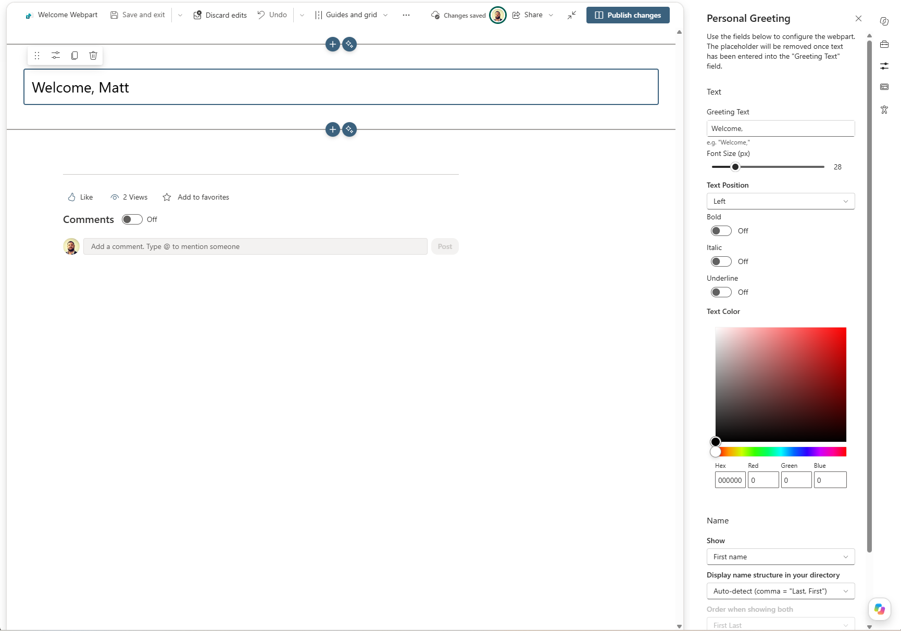
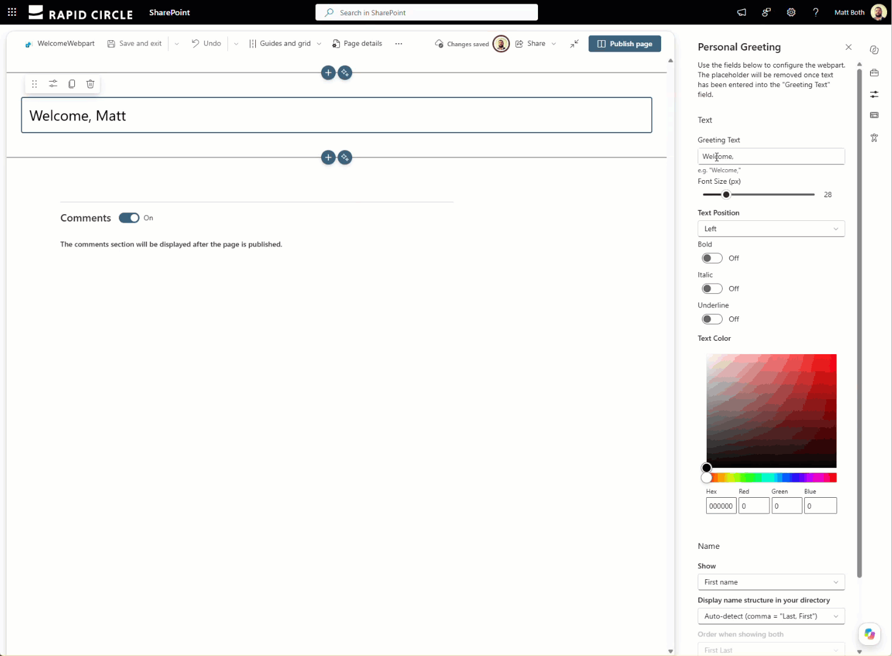

# SPFx Personal Greeting Web Part

A SharePoint Framework (SPFx) web part that greets the current user by name, with full control over text styling and how the name is displayed.



## Demo



## Features

| Property | Description |
|---|---|
| Greeting Text | Text shown before the name, e.g. `Welcome,` |
| Font Size | 10-96px slider |
| Text Position | Left, center or right |
| Bold / Italic / Underline | Independent toggles |
| Text Color | Fluent UI colour picker |
| Show | First name, last name, or both |
| Display name structure | How names are written in your directory: auto-detect, `First Last`, or `Last, First` |
| Order when showing both | `First Last` or `Last, First` |

### Avoiding "LastName, FirstName" situations

Many directories store display names as `LastName, FirstName`, which can produce greetings like "Welcome, LastName". The web part parses the display name using the **Display name structure** setting, so choosing "First name" shows only the first name, "Last name" shows only the last name, and "Both" shows `FirstName LastName` (or `LastName, FirstName` if you pick that order). With **Auto-detect**, a comma means `LastName, FirstName`. If a name has only one part, that part is shown.

Parsing logic lives in [`src/webparts/personalGreeting/components/nameUtils.ts`](src/webparts/personalGreeting/components/nameUtils.ts).

## Compatibility


Built with Node.js 24 as well, but SPFx 1.23 officially supports Node 22 (`>=22.14.0 <23.0.0`). See <https://aka.ms/spfx-matrix>.

## Getting started

### Download

Grab `spfx-greeting-webpart.sppkg` from the [latest release](https://github.com/MattBoth/spfx-greeting-webpart/releases/latest) and upload it to your tenant app catalog.

### Build from source

```powershell
npm install
npm run build        # produces sharepoint/solution/spfx-greeting-webpart.sppkg
```

- **Deploy:** upload the `.sppkg` to your tenant app catalog, add the app to a site, then add the **Personal Greeting** web part to a page.
- **Hosted workbench:** replace `{tenantDomain}` in `config/serve.json` with your tenant domain and run `npm run start`.

## Project structure

```
src/webparts/personalGreeting/
  PersonalGreetingWebPart.ts          Web part class and property pane
  PersonalGreetingWebPart.manifest.json  Manifest and default property values
  components/
    PersonalGreeting.tsx              Rendering
    IPersonalGreetingProps.ts         Component props
    nameUtils.ts                      Display name parsing and formatting
```

## License

[MIT](LICENSE). Portions derived from the PnP sample, © Microsoft Corporation.
